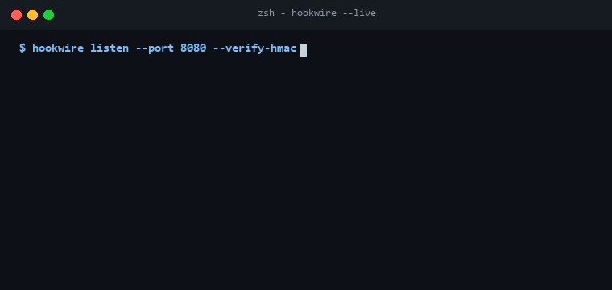

<p align="center">
  
</p>

<p align="center">
  <a href="https://github.com/Gaurav28-tech/hookwire/actions"></a>
  <a href="LICENSE"></a>
  
  
</p>

<p align="center">
  <b>Hookwire</b> is a resilient webhook delivery and ingestion pipeline built for event-driven microservices. It safeguards webhooks against replay attacks using cryptographic HMAC signatures, enforces idempotent execution, and guarantees at-least-once delivery with exponential backoff and Dead-Letter Queue (DLQ) support.
</p>

---

## ⚡ Live Terminal Preview

<p align="center">
  
</p>

---

## 🚀 Key Capabilities

- **HMAC-SHA256 Signatures**: Generates and verifies cryptographic signatures with constant-time comparison to prevent timing attacks.
- **Idempotency Guard**: Sliding TTL memory store ensuring incoming duplicate webhook deliveries are safely rejected.
- **Exponential Backoff**: Automated delivery retries with exponential backoff and jitter calculations.
- **Dead-Letter Queue (DLQ)**: Exhausted delivery attempts are automatically isolated to a persistent DLQ for inspection.
- **Zero Heavy Dependencies**: Pure standard library Python with zero broker dependencies.

---

## 🏗️ Architecture

<p align="center">
  
</p>

---

## 📦 Quickstart

### Installation

```bash
git clone https://github.com/Gaurav28-tech/hookwire.git
cd hookwire
```

### Basic Usage

```python
from relay.verifier import SignatureVerifier
from relay.queue import RetryQueue
from relay.models import WebhookEvent

# Sign and verify incoming webhook payloads
secret = "whsec_supersecretkey123"
payload = '{"event": "payment.succeeded", "amount": 4900}'
sig = SignatureVerifier.sign(payload, secret)

is_valid = SignatureVerifier.verify(payload, sig, secret)
print(f"Signature Valid: {is_valid}")

# Queue for resilient delivery with exponential backoff
queue = RetryQueue(max_retries=3, base_backoff_seconds=1.0)
event = WebhookEvent(id="evt_001", target_url="https://api.partner.com/webhook", payload=payload)
queue.enqueue(event)
```

### Running Test Suite

```bash
python -m unittest discover -s tests -p "test_*.py"
```

---

## 📄 License

Distributed under the [MIT License](LICENSE).
